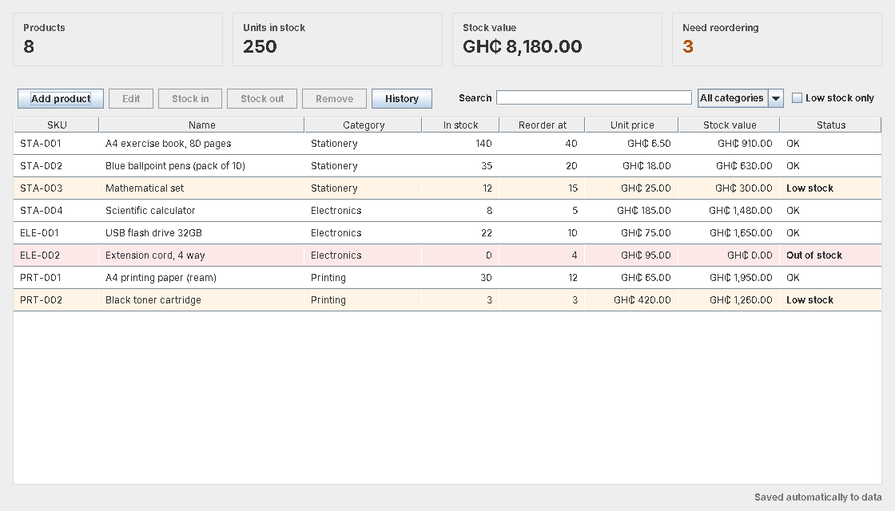

# Java Inventory System

A desktop stock manager for a small shop, written in plain Java with Swing.



This is a rebuild of an inventory system I made in college. The original code was lost along with my laptop before I'd pushed it to GitHub, so I rewrote it from scratch, keeping the same idea and cleaning up the design.

## What it does

* Add, edit and remove products (SKU, name, category, reorder level, unit price)
* Record stock coming in and going out, with a note for each movement
* Refuses to issue more than you have, so stock never goes negative
* Highlights low stock and out of stock items and counts how many need reordering
* Search by SKU, name or category, filter by category, or show low stock only
* Running totals for products, units and stock value (GH₵)
* Full history of every stock movement
* Saves automatically to CSV files you can also open in Excel

## Run it

You need Java 17 or newer (`java -version` to check).

```sh
./run.sh          # macOS / Linux
run.bat           # Windows
```

The first launch fills in a few sample stationery products. Your data is saved in a `data` folder next to where you run it. To use a different folder, pass it in: `./run.sh path/to/folder`.

Run the tests:

```sh
./test.sh         # or test.bat
```

## How it's put together

```
src/main/java/com/benedict/inventory/
  model/     Product, StockMovement      what a product is and the rules it follows
  service/   Inventory                   the stock list and every change to it
  storage/   CsvInventoryStore, Csv      saving to and loading from CSV
  ui/        InventoryApp, dialogs       the Swing window
src/test/java/.../InventoryTests.java    tests with a tiny built-in harness
```

A few decisions worth pointing out:

* **Encapsulation.** `Product` only lets quantity change through `addStock` and `removeStock`, which validate the amount. Nothing else can set stock directly.
* **One place for the rules.** The window never edits products itself. It calls `Inventory`, which validates, applies the change and records a `StockMovement`.
* **Money uses `BigDecimal`**, not `double`, so prices and totals don't pick up rounding errors.
* **Safe saving.** Files are written to a temporary file first and then moved into place, so a crash mid-save can't corrupt your data.
* **No dependencies.** Only the JDK, so it builds anywhere Java is installed.

## Built by

Benedict Frimpong Boateng. See more of my work on my [portfolio](https://benedict-frimpong-boateng.vercel.app) or connect on [LinkedIn](https://www.linkedin.com/in/benedict-frimpong-boateng-552490249/).
